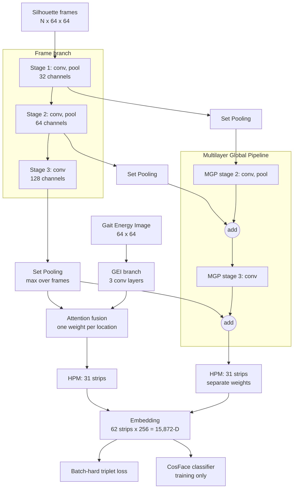
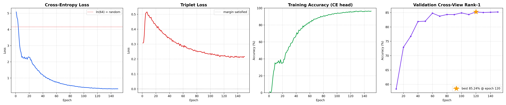
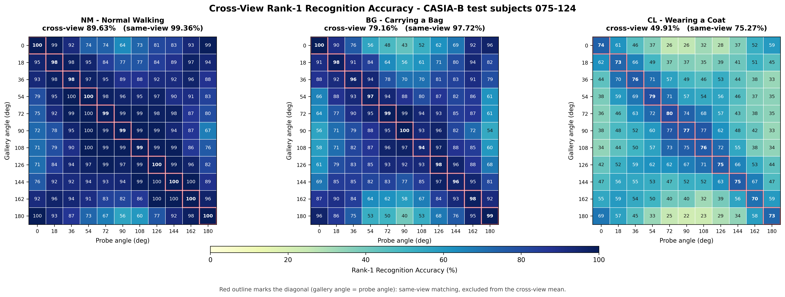
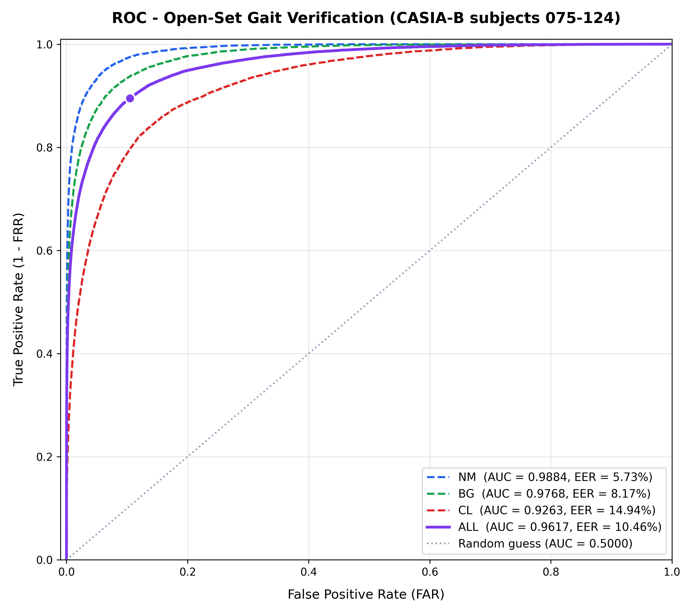
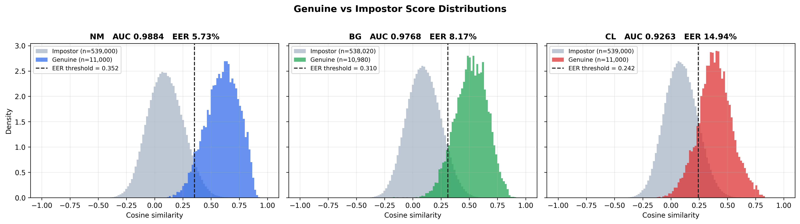
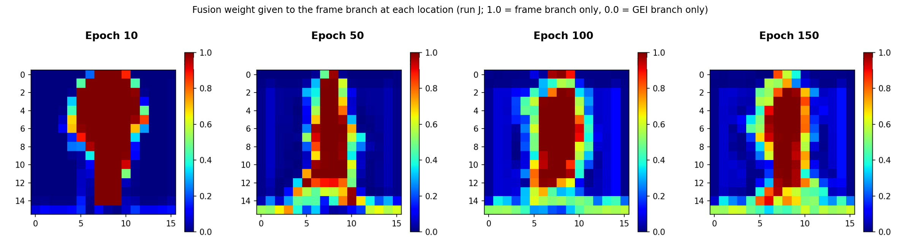

# Cross-View Gait Recognition via Multimodal Fusion

### A Deep Learning Pipeline for Human Identification Combining a Modified GaitSet Backbone with Multimodal Feature Fusion

---

## Introduction

Gait is a behavioral biometric — it identifies people by how they walk rather than by a static physical trait. Because it can be captured from a distance and does not require the subject's cooperation, unlike face or fingerprint recognition, gait analysis is well suited to surveillance, forensics, and security applications.

This repository contains a full implementation of a multimodal gait recognition framework built on a modified GaitSet backbone, based on the paper *"Research on Gait Recognition Based on GaitSet and Multimodal Fusion."*

Rather than relying on silhouettes alone, the system fuses the set of silhouette frames with a Gait Energy Image (GEI) through an attention-based fusion module. It then describes each walker with a part-based embedding (Horizontal Pyramid Mapping), enriched by GaitSet's Multilayer Global Pipeline.

The pipeline was trained and evaluated on the CASIA-B benchmark across three walking conditions:

- Normal walking (NM)
- Carrying a bag (BG)
- Wearing a coat (CL)

End to end, the project covers silhouette normalisation, GEI generation, multimodal feature fusion, part-based embedding learning, cross-view Rank-1 identification, and open-set verification (ROC / EER). The silhouettes come pre-extracted with CASIA-B; the code does not process raw video.

---

## Key Features

- GaitSet-style frame branch: a CNN on every silhouette frame, then Set Pooling across frames
- A second branch on the Gait Energy Image, blended with the first by per-location attention
- Multilayer Global Pipeline: set-level features taken from several depths of the frame branch
- Horizontal Pyramid Mapping: 62 horizontal strips, each with its own projection, so matching is part-to-part
- CosFace classifier and batch-hard triplet loss, trained jointly
- Occlusion augmentation that simulates coats and bags
- Standard CASIA-B cross-view evaluation, plus ROC-AUC and Equal Error Rate for verification
- Seeded, resumable training that refuses incomplete datasets
- PyTorch with mixed precision; trains on a 6 GB GPU

---

## Architecture

The model has two branches. The **frame branch** runs a small CNN on every silhouette frame and keeps the element-wise maximum across frames (Set Pooling), so the result does not depend on frame order or count. Its **Multilayer Global Pipeline** also pools the set at two intermediate depths and refines those maps in a parallel, set-level stream. The **GEI branch** runs the same CNN design on the Gait Energy Image.

An attention module blends the two branches location by location. **Horizontal Pyramid Mapping** then cuts both the fused map and the MGP map into 31 horizontal strips each, projects every strip with its own weights, and concatenates the 62 unit-length strips into one embedding. Comparing two embeddings by cosine similarity is therefore the same as averaging 62 strip-to-strip comparisons.



<p align="center">
<b>Figure 1.</b> The implemented model (reference configuration: <code>--neck hpm --mgp</code>).
</p>

| Component | Parameters | Share |
|:----------|-----------:|------:|
| Frame branch, 3 conv layers | 93,632 | 2.8% |
| Multilayer Global Pipeline | 92,736 | 2.8% |
| GEI branch, 3 conv layers | 93,632 | 2.8% |
| Attention fusion | 16,578 | 0.5% |
| Horizontal Pyramid Mapping, 62 strips | 2,031,616 | 60.8% |
| CosFace classifier, training only | 1,015,808 | 30.4% |
| **Total** | **3,344,002** | |

The classifier is discarded at test time, so the model that produces embeddings has 2,328,194 parameters. The original single-vector head is still available (`--neck flatten`) to reproduce earlier runs.

---

## Repository Layout

```text
Gait-Multi-Modal-Fusion
│
├── docs/                     # Images used in this README
│
├── GaitDatasetB-silh/         # Raw CASIA-B silhouettes (not included)
├── Processed_CASIAB/          # Original preprocessing (.npy), kept to reproduce runs A-E
├── Processed_CASIAB_v2/       # Aspect-preserving preprocessing (.npy), used from run F on
│
├── results/                   # One folder per training run: checkpoints, curves, history
│
├── preprocess.py              # Silhouette normalisation and GEI generation
├── pack_npy.py                # Packs PNG output into .npy (not needed with --npy-only)
├── dataset.py                 # CASIA-B loader, PK batch sampler, augmentation
├── model.py                   # Two-branch model, MGP, HPM, CosFace head
├── train.py                   # Training with validation, seeding and resume
├── eval.py                    # Cross-view Rank-1 evaluation; saves embeddings
├── compute_biometrics.py      # ROC / AUC / EER from saved embeddings
├── plot_view_matrix.py        # Cross-view accuracy heatmap from saved embeddings
│
├── requirements.txt
└── README.md
```

---

## Background

Gait recognition identifies people from the pattern of their walk. Because it works at a distance and does not require cooperation, it has drawn sustained interest for surveillance, border control, forensics, and smart-city applications.

The original GaitSet model treated a walking sequence as an unordered set of silhouette frames, a design that pushed cross-view recognition forward considerably. Its main weakness is that it depends entirely on silhouette shape, which makes it sensitive to anything that changes the outline of the body, such as heavy coats or carried bags.

This project follows the approach described in *"Research on Gait Recognition Based on GaitSet and Multimodal Fusion."* Instead of a single silhouette stream, the model learns from:

- Pose-by-pose detail, from the set of silhouette frames
- A whole-sequence summary, from the Gait Energy Image
- A location-by-location weighting of the two, from an attention fusion module

Whether the GEI adds information the frame set lacks has not been measured. It is the pixel-wise mean of the same frames the frame branch receives, so it may be largely redundant; see [Future Work](#future-work).

---

## Dataset

Training and evaluation were carried out on CASIA-B, one of the standard benchmarks for cross-view gait recognition.

| Property | Value |
|----------|-------|
| Dataset | CASIA-B |
| Subjects | 124 |
| Camera views | 11 (0°–180°) |
| Walking conditions | Normal (NM), Bag (BG), Coat (CL) |
| Training subjects | 001–064 |
| Validation subjects | 065–074 |
| Test subjects | 075–124 |
| Gallery sequences | NM-01 to NM-04 |
| Probe sequences | NM-05/06, BG-01/02, CL-01/02 |

CASIA-B's range of viewpoints and appearance conditions makes it a demanding, and informative, testbed for this type of model.

---

## Getting Started

To reproduce the results or train the model from scratch, see the full setup walkthrough, covering installation, environment configuration, dataset preparation, and training.

**[Getting Started Guide](docs/GETTING_STARTED.md)**

---

## Results & Performance

This section covers how the model trained, how accurately it identifies subjects, how well it performs at verification, and what its attention mechanism learned over the course of training.

### Evaluation Protocol

Protocol choices move these numbers substantially, so they are stated up front. Gallery and probe sets come from subjects 075–124, which are disjoint from every identity seen during training.

| Item | Setting |
|:-----|:--------|
| Training identities | 001–064 |
| Validation identities | 065–074, held out for checkpoint selection |
| Test identities | 075–124, never seen during training or model selection |
| Gallery | `nm-01`–`nm-04`, averaged into one template per (subject, angle) — 550 templates |
| Probes | NM: `nm-05`, `nm-06` · BG: `bg-01`, `bg-02` · CL: `cl-01`, `cl-02` |
| Matching | Cosine similarity on L2-normalised embeddings (15,872-D for the reference model) |
| Frames | All frames per sequence; Set Pooling is invariant to sequence length |
| Cross-view averaging | All 11 × 11 gallery/probe angle pairs, excluding the identical-view diagonal |
| Verification pairing | Every probe against every template, identical-view pairs excluded |

Matching a probe against gallery footage from the *same* camera angle is a considerably easier problem than genuine cross-view recognition, so the diagonal is excluded from the headline figures. Both are reported below, since the gap between them is itself informative.

Evaluation is deterministic for a fixed `--frame-budget`, though changing it can shift individual figures by up to about 0.1 point: batch shapes change, cuDNN selects different convolution algorithms, and the resulting floating-point differences flip a small number of near-tied nearest-neighbour decisions. Only CL is measurably affected, as it has the narrowest genuine/impostor margin. All figures here use the default budget of 768.

Training introduces far more variation than evaluation does. Run H2 repeated run H exactly except for the random seed, and overall cross-view Rank-1 moved by 1.29 points. Differences of that size between single training runs should not be read as effects. Runs from H2 onward are seeded (`--seed`) and record their seed in `history.json`; earlier runs were not seeded.

### Summary

Figures below are for the reference model, run J: corrected preprocessing, occlusion augmentation, Horizontal Pyramid Mapping and the Multilayer Global Pipeline.

| Metric | Cross-view | Same-view |
|:-------|:----------:|:---------:|
| Overall Rank-1 accuracy | **72.90%** | 90.79% |
| Normal walking (NM) | **89.63%** | 99.36% |
| Bag carrying (BG) | **79.16%** | 97.72% |
| Coat wearing (CL) | **49.91%** | 75.27% |

| Verification | AUC | EER | Threshold |
|:-------------|:---:|:---:|:---------:|
| Normal walking (NM) | **0.9884** | **5.73%** | 0.3524 |
| Bag carrying (BG) | **0.9768** | **8.17%** | 0.3103 |
| Coat wearing (CL) | **0.9263** | **14.94%** | 0.2420 |
| Combined | **0.9617** | **10.46%** | 0.2879 |

Under normal walking the model picks the right person out of 50 in 89.6% of cross-view comparisons. A carried bag costs about 10 points and a coat about 40, so coat wearing remains the clear weak point. Verification is stronger than identification, as expected: deciding whether one pair matches is easier than choosing the right identity from 50 candidates. Under normal walking the EER is 5.7%.

> **Coat wearing is the exception.** Run E, which combines the original preprocessing, occlusion augmentation and the old single-vector head, still scores highest on CL: 52.83% against J's 49.91%. J leads overall by almost 4 points (72.90% against 69.07%). See [Development History](#development-history).

### Training Behavior

Training is tracked using cross-entropy loss, batch-hard triplet loss, training accuracy, and cross-view Rank-1 on the held-out validation identities, over 150 epochs.

<p align="center">
  
</p>

<p align="center">
<b>Figure 2.</b> Run J: cross-entropy loss, batch-hard triplet loss, training accuracy, and validation cross-view Rank-1. The dotted line on the first panel marks ln(64), the loss of a uniform random guess.
</p>

Cross-entropy starts above the random-guess line, because the CosFace margin initially penalises the true class, then falls steadily to about 0.33. The batch-hard triplet loss rises over the first few epochs while that margin is phased in, then falls steadily to about 0.21.

Training accuracy climbs to about 96% and levels off, staying above 90% from epoch 76. That is a change from the earlier single-vector head, which memorised all 64 training identities, reaching 100% by about epoch 30. With Horizontal Pyramid Mapping the model is less than half the size and no longer saturates.

Validation Rank-1 on the held-out identities rises quickly and plateaus at about 84–85% from epoch 60. The checkpoint with the best validation score (epoch 120) is the one evaluated.

An earlier revision of this section claimed training "converges smoothly, with no signs of instability." That was measured on a run that never converged at all; see [Corrections](#corrections-to-previously-reported-results).

### Identification Results

Rank-1 accuracy, the percentage of probes correctly matched to their identity as the top candidate, was measured separately for NM, BG, and CL conditions. The full 11 × 11 matrix is reported rather than a single averaged figure, since performance depends heavily on the angle between the gallery and probe cameras.

<p align="center">
  
</p>

<p align="center">
<b>Figure 3.</b> Cross-view Rank-1 accuracy for every gallery/probe angle pair. Rows are gallery angles, columns are probe angles. The red-outlined diagonal is same-view matching and is excluded from the cross-view mean.
</p>

Normal walking reaches 89.63% across camera angles. Bag carrying reaches 79.16%: a carried object changes part of the silhouette but leaves most of the walking motion intact. Coat wearing is lowest at 49.91%, because heavy clothing changes the outline over most of the body.

Part-based matching was expected to help most with coats, since strips covering the legs should be unaffected. In practice Horizontal Pyramid Mapping raised normal and bag accuracy far more than coat accuracy; see [Development History](#development-history).

The overall cross-view accuracy is 72.90%.

Three patterns in the matrix are worth noting, all physically meaningful rather than artefacts of the measurement. Figures are for normal walking.

- **Accuracy falls as the angle gap widens:** 97.5% for gaps of up to two steps, 86.7% for gaps of six or more. This is the expected signature of a view-dependent representation.
- **The 0° and 180° probe columns are weakest:** 83.9%, against 89.3% for the mid-range views. A person walking straight toward or away from the camera shows far less sideways limb motion.
- **Opposite extremes recover sharply:** gallery 0° against probe 180° reaches 99%, because those two viewpoints are near-mirror images of the same walk.

### Verification Results

Beyond identification, the framework was evaluated on its ability to distinguish genuine matches from impostors. This is the open-set question relevant to deployment: whether a *single* global similarity threshold can accept genuine pairs and reject impostors across identities the model has never seen.

<p align="center">
  
</p>

<p align="center">
<b>Figure 4.</b> ROC curves per walking condition and combined, computed from real gallery and probe embeddings with identical-view pairs excluded.
</p>

| Probe | AUC | EER | Threshold | Genuine mean | Impostor mean |
|:------|----:|----:|----------:|-------------:|--------------:|
| NM | 0.9884 | 5.73% | 0.3524 | +0.5975 | +0.0983 |
| BG | 0.9768 | 8.17% | 0.3103 | +0.5155 | +0.0980 |
| CL | 0.9263 | 14.94% | 0.2420 | +0.3907 | +0.0891 |
| Combined | 0.9617 | 10.46% | 0.2879 | +0.5013 | +0.0951 |

A combined AUC of 0.9617 shows the embedding space separates genuine from impostor pairs well, rising to 0.9884 under normal walking alone. The EER, the point at which false acceptance and false rejection rates are equal, is 10.46% combined and 5.73% for NM.

The threshold does not transfer across conditions. It falls from 0.35 under NM to 0.24 under CL as genuine-pair similarity drops, so a system running one fixed cutoff would either admit impostors under NM or turn away genuine users under CL. That is why all four thresholds appear above.

Verification barely changed with the Multilayer Global Pipeline. Run J's combined AUC is 0.0015 above the mean of runs H and H2, about the same as the 0.0014 gap between those two identical-configuration runs. The pipeline's gain shows up in identification, not verification.

Absolute similarity values are not comparable across model revisions — the CosFace head reshapes the angular geometry of the embedding space, so thresholds here sit lower than in earlier revisions while separating the two distributions better. What matters is the gap between the genuine and impostor means, not either value alone.

<p align="center">
  
</p>

<p align="center">
<b>Figure 5.</b> Genuine and impostor cosine similarity distributions per condition. The overlap between the two is what sets the achievable EER.
</p>

Figure 5 shows why CL is the hardest case, and the mechanism is more specific than "clothing hurts." The impostor distribution barely moves across conditions, staying between +0.09 and +0.10. What changes is the genuine distribution, which slides down and broadens from +0.60 under NM to +0.39 under CL. The failure is a loss of similarity between genuine pairs, not an increase in false matches, which points at feature extraction rather than at the decision rule.

### Attention Visualization

At each of its 16 × 16 locations, the fusion module decides how much to trust each branch. Figure 6 shows the weight it gave the frame branch during training of run J.

<p align="center">
  
</p>

<p align="center">
<b>Figure 6.</b> Weight given to the frame branch at each location, at epochs 10, 50, 100 and 150 of run J (1.0 = frame branch only, 0.0 = GEI branch only). Each panel shows a single training sample, and a different one each time.
</p>

Over the body the module relies almost entirely on the frame branch; elsewhere the weight shifts to the GEI branch. From epoch 50 on, the high-weight region narrows to the core of the body, with intermediate weights along its edges and across the bottom row.

Because every panel shows a different sample, differences between panels mix training progress with differences between subjects and viewing angles. They show what the module does, not a precise record of how it changed.

---

## Limitations

**Sensitivity to clothing.** CL accuracy (49.91%) lags NM (89.63%) and BG (79.16%) by a wide margin. It is also the one condition where an older configuration (run E, 52.83%) still scores higher. Part-based matching was expected to protect the leg strips from a coat, but it lifted CL far less than the other conditions.

**Small effects are within run-to-run noise.** An exact repeat of run H with a new seed moved overall accuracy by 1.29 points. Most rows in [Development History](#development-history) are single runs, so differences below about 2 points between them are not established. That includes CosFace's +1.03.

**The validation set is small.** Ten held-out identities select each run's checkpoint, and they ranked runs differently from the test set three times. Runs are compared on the test split for that reason.

**Preprocessing and occlusion augmentation interact.** Occlusion augmentation gained 8.41 points on the original preprocessing but far less on the corrected one, and a lower occlusion rate did not resolve it. See [Development History](#development-history).

**Verification thresholds are condition-specific.** The optimal cutoff varies from 0.35 (NM) to 0.24 (CL), so a single fixed threshold would not serve all conditions equally.

**Dependence on silhouette quality.** The pipeline's output is only as good as the silhouette extraction step; segmentation noise or incomplete masks degrade downstream features. A handful of CASIA-B test sequences contain as few as two usable frames, and these are evaluated as-is rather than excluded.

**Single-dataset evaluation.** All results reported here are on CASIA-B; generalization to other gait datasets has not been tested.

**Controlled-capture assumption.** The current setup does not account for poor lighting, occlusion, crowding, or uneven terrain, all of which are common in real-world deployments.

---

## Development History

Every change below was measured on the held-out test identities, one change at a time, against the run it was built on, so each row's delta is attributable. Overall cross-view Rank-1:

| Run | Data | Occlusion | Change (built on) | NM | BG | CL | **Overall** | Δ |
|:----|:----:|:---------:|:------------------|---:|---:|---:|------------:|---:|
| — | v1 | – | Starting point, correct protocol | 71.24 | 57.65 | 31.18 | **53.36** | — |
| A | v1 | – | Epoch defined by sequences, larger PK batch | 77.61 | 62.41 | 38.88 | **59.63** | +6.27 |
| B | v1 | – | CosFace head (A) | 77.05 | 63.77 | 41.15 | **60.66** | +1.03 |
| C | v1 | – | LR 1e-4 with warmup (B) | 72.11 | 55.67 | 34.95 | **54.24** | −6.42 |
| D | v1 | 0.3 | 400 epochs, occlusion (C) | 70.22 | 56.27 | 40.35 | **55.61** | +1.37 |
| E | v1 | 0.3 | Occlusion (B) | 82.04 | 72.34 | 52.83 | **69.07** | +8.41 |
| F | **v2** | – | Aspect-preserving preprocessing (B) | 79.59 | 66.87 | 44.75 | **63.74** | +3.08 |
| F2 | **v2** | 0.3 | Aspect-preserving preprocessing (E) | 78.31 | 69.06 | 50.62 | **65.99** | −3.08 |
| G | **v2** | 0.15 | Occlusion 0.15 instead of 0.3 (F2) | 75.69 | 64.50 | 44.69 | **61.63** | −4.36 |
| H | **v2** | 0.3 | Horizontal Pyramid Mapping head (F2) | 86.39 | 76.04 | 47.21 | **69.88** | +3.89 |
| H2 | **v2** | 0.3 | Exact repeat of H, new seed | 87.53 | 77.24 | 48.74 | **71.17** | +1.29 |
| **J** | **v2** | 0.3 | **Multilayer Global Pipeline (H)** | 89.63 | 79.16 | 49.91 | **72.90** | +2.38 |

H2's Δ is against H and measures run-to-run noise rather than a change. J's Δ is against the mean of H and H2.

Seven findings are worth recording.

**Training-loop correctness came first.** Run A is a single change with no new architecture: the batch sampler previously defined an epoch as one pass over *identities* rather than sequences, yielding 18 batches per epoch and about 1,350 optimizer steps across an entire 150-epoch run. Cross-entropy never left the random-guess region. Fixing the epoch definition was worth 6.27 points on its own, more than any single architectural change, and every later result depends on it.

**A plausible hyperparameter change cost 6.4 points.** Run C lowered the learning rate to 1e-4 with warmup, a conventional and defensible choice. It was worse at every validation checkpoint. Because the ablation ladder is cumulative, run D inherited that damage — which is why run D's occlusion augmentation appeared to be worth almost nothing. Re-testing the same augmentation on the healthy configuration (run E) showed it was worth **+8.41**, the largest single gain in the project. Ablating one change at a time is what surfaced this; a single combined run would have buried it.

**Preprocessing helps, but only in the absence of occlusion augmentation.** Fixing the aspect-ratio distortion is worth +3.08 without occlusion (B → F) and −3.08 with it (E → F2). The symmetry is striking and the cause is not established. The plausible reading is that both changes address the same weakness, over-reliance on precise silhouette geometry, so their benefits overlap. Run G tested a lower occlusion rate (0.15) and scored lower still. Across rates of 0, 0.15 and 0.3 the corrected pipeline gave 63.74%, 61.63% and 65.99%: a non-monotonic pattern better explained by run-to-run noise, discussed below, than by the occlusion rate.

**Identification and verification did not always rank the models identically.** Before the head was replaced, run E led on cross-view Rank-1 (69.07% against 65.99%) while F2 led on verification (AUC 0.9486 against 0.9401). Run J now leads on both, though only narrowly on verification, and E still leads on coat wearing.

**Replacing the single-vector head shrank the model and raised accuracy.** The original head flattened the fused feature map and projected it into one 256-D vector, through a single fully connected layer holding 97.4% of the model's parameters. Horizontal Pyramid Mapping replaces it with 31 small per-strip projections. Run H cut the model from 8.6M to 1.7M parameters, gained 3.89 points overall, and stopped memorising the training set (95% training accuracy instead of 100%). The gain was uneven: NM +8.1 and BG +7.0, but CL −3.4.

**Single runs carry roughly one to two points of noise.** Run G's non-monotonic occlusion results were the first sign. An exact repeat of run H with a new seed (H2) then landed 1.29 points away from the original. Differences below about 2 points between single runs, including several in the table, are not established.

**The Multilayer Global Pipeline helped, by a rule fixed in advance.** GaitSet's own ablation reports MGP gains of +1.3 (NM), +3.0 (BG) and +1.0 (CL), close to the noise above. So run J was compared against both H and its repeat H2, under a decision rule written down before training: J had to beat both, by more than their own 1.29-point gap.
- It did: 72.90% against 69.88% and 71.17%, which is 1.73 points above the better run and 2.38 above their mean.
- Each condition improved by more than its own H-to-H2 gap: NM +2.67, BG +2.52, CL +1.94.
- Same-view accuracy and verification did not change, so the gain is specific to matching across camera angles.
- Two caveats remain. The noise estimate rests on a single repeat. And the gain cannot be split between MGP's own convolutions (93K parameters) and the extra 31 strips it brings (1.5M parameters with their classifier weights).

A methodological caveat applies to the whole table. Runs A–E were measured on the pre-fix preprocessing. Conclusions that depend on optimizer step count (run A) transfer to the corrected data with confidence; the smaller effects, particularly the CosFace margin, have not been re-verified on it. Runs before H2 were also not seeded.

---

## Future Work

- The deep, six-layer backbone: implemented (`--depth deep`) but not yet trained with HPM or MGP, although GaitSet's MGP was designed around it
- Repeated seeds for each configuration, to put error bars on the Development History table
- A larger validation split, since ten identities have ranked runs differently from the test set
- Coat robustness, the weakest condition and the one where an older configuration still leads, including entropy-based representations that encode only the moving regions of the body
- A 64×44 input crop, the GaitSet convention, since the aspect-preserving silhouette occupies only about 24 of 64 columns
- A genuinely complementary second modality: the GEI is the pixel-wise mean of the same frames the dynamic branch already receives, so the fusion module currently weighs two views of one signal
- Skeleton- or pose-based features alongside silhouette and GEI for complementary motion cues
- Transformer-based or other advanced attention mechanisms for fusion
- Cross-dataset evaluation to test generalization beyond CASIA-B
- Adaptation to real-world surveillance conditions, including lighting, clutter, and occlusion
- Model compression and inference optimization for edge deployment

---

## Corrections to Previously Reported Results

An earlier revision of this README reported figures that were produced incorrectly. They have been replaced with measured values, and the causes are recorded here.

**Identification used a same-view protocol.** Each probe was matched only against gallery sequences recorded from its own camera angle, which is same-view rather than cross-view recognition. The previously reported NM 98.00% / BG 82.24% / CL 45.36% correspond to the diagonal of Figure 3 and remain reproducible as the same-view column in the Summary. The cross-view figures now reported follow the standard protocol with that diagonal excluded.

**Verification metrics were computed from random data.** `compute_biometrics.py` contained a test harness that generated `np.random.randn` vectors, and the scoring function was never called with real embeddings. The previously reported AUC 0.5876 / EER 44.94% / threshold 0.0094 were that harness's output; a near-chance AUC paired with a near-zero threshold is the signature of unrelated random vectors rather than of this model. The measured values are substantially better than the figures they replace.

**The cross-view matrix was generated by a formula.** `plot_view_matrix.py` filled each cell with `92.0 - (angle_distance * 6.5)` plus seeded noise and never loaded the model. Figure 3 is now computed from real embeddings.

**Training was described as converging when it never did.** The claim that training "converges smoothly, with no signs of instability" was made about a run that completed roughly 1,350 optimizer steps in total, because the batch sampler defined an epoch as one pass over identities rather than sequences. Cross-entropy started at ln(74) = 4.30 — exactly the random-guess value — and had only reached 3.12 after 150 epochs, still falling linearly. The curves were smooth because the run stopped long before anything interesting happened.

**Preprocessing was distorting the data rather than normalising it.** `crop_and_resize` cropped each silhouette to its bounding box and resized it to a square. Measured across 720 frames spanning every subject, condition and angle, the raw CASIA-B silhouettes are *already* 64×64, already span the full height, and are already horizontally centred to within a pixel. The step therefore normalised nothing and did nothing but stretch the width — by a median of 2.67× and up to 4.57×, varying 2.47× from frame to frame within a single sequence as the limbs moved. Set Pooling was taking a maximum over frames whose geometry disagreed, and the GEI was averaging bodies at inconsistent widths; roughly 45% of GEI pixels were ambiguous mid-grey blur, against 14% after the fix.

**The architecture diagram showed components the code never had.** The previous Figure 1 depicted background subtraction on raw video, a third "Gait Energy Motion" pathway based on optical flow, a concatenating channel-fusion layer and batch-all triplet loss. None of these existed. The silhouettes come pre-extracted, the model has only ever had two input branches, fusion is a per-location weighted sum, and the triplet loss uses batch-hard mining. Figure 1 now shows the implemented model.

**The fusion module was described as channel attention.** It predicts one weight per spatial location for each branch, shared across all channels, which makes it spatial attention.

**A previous revision understated the original head's size.** It said the single fully connected layer held "roughly 85%" of the parameters. Measured, it held 97.4% (8,388,864 of 8,612,236).

Several changes were made to prevent this class of error from recurring:

- `eval.py` is the only script that loads the model. It performs a single GPU pass and writes `results/embeddings.npz`, which the reporting scripts consume rather than constructing their own inputs.
- Before reporting anything, `eval.py` asserts embeddings are unit-norm and prints mean genuine against mean impostor similarity, warning explicitly if the two are indistinguishable.
- `compute_biometrics.py` emits the score distributions in Figure 5 alongside the ROC, where a degenerate result is immediately visible rather than hidden inside a summary statistic.
- `train.py` refuses to start if the dataset is missing identities or the validation split is empty, rather than silently training on a fraction of the data. An interrupted preprocessing run had previously produced a model fitted to 21 identities instead of 64, with no validation and therefore no saved checkpoint.
- Training writes a resumable checkpoint every epoch, written atomically so an interrupt cannot leave a truncated file, and refuses to resume if any run-defining argument has changed.
- `preprocess.py --compare` renders a before/after figure so a normalisation change can be inspected on a handful of sequences before committing to reprocessing the dataset.
- Training runs record their random seed. Changes whose expected effect is close to the run-to-run noise are tested against a repeat of the baseline, under a decision rule written down before training.

The broader lesson is that each of these errors came from trusting a description of what code did instead of measuring what it produced. The preprocessing bug in particular survived because the function was named `crop_and_resize` and appeared to normalise; only measuring the raw data revealed there was nothing left to normalise.

---

## Acknowledgements

This project builds on prior open research and public datasets:

- **CASIA-B Gait Dataset**, the benchmark dataset used throughout this work.
- **[GaitSet: Cross-View Gait Recognition Through Utilizing Gait As a Deep Set](https://ieeexplore.ieee.org/document/9351667)**, the set-based representation this implementation extends.
- **[Research on Gait Recognition Based on GaitSet and Multimodal Fusion](https://ieeexplore.ieee.org/document/10852208)**, the source of the multimodal attention-fusion approach used here.
- **PyTorch** and its open-source community, on which the implementation is built.

Thanks also to the faculty and mentors who supported this project's development.
